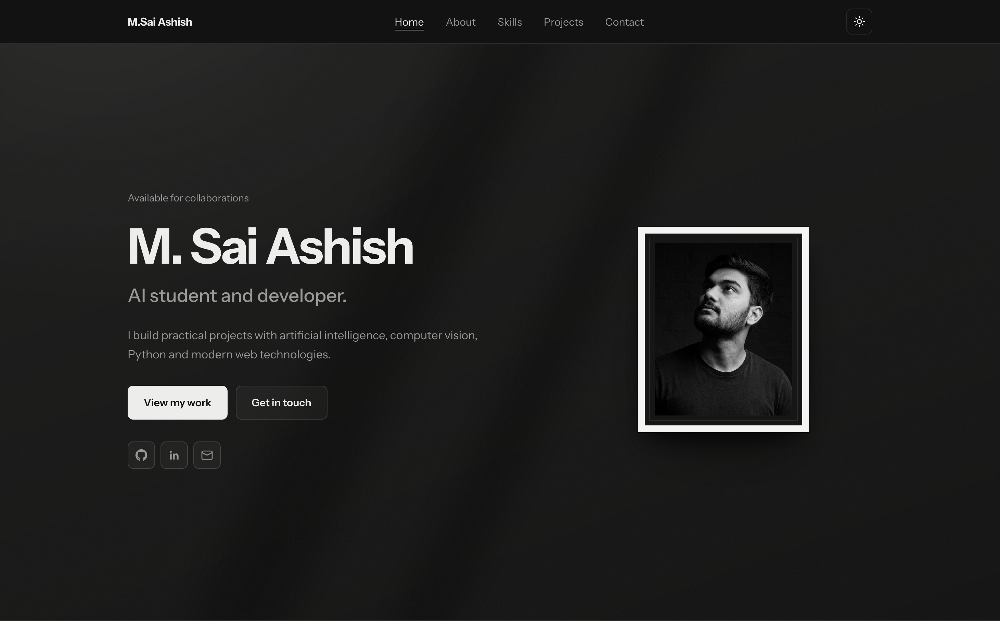
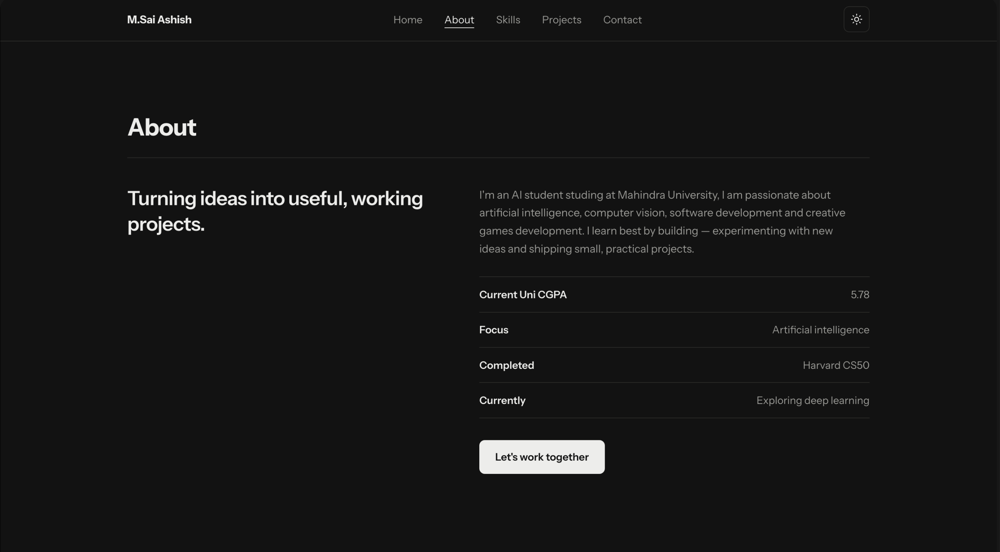
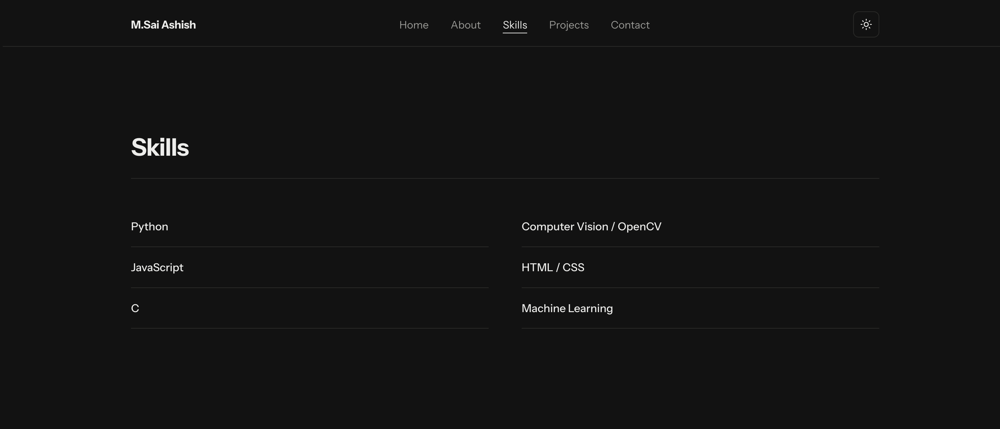
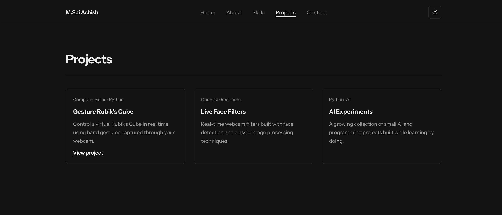
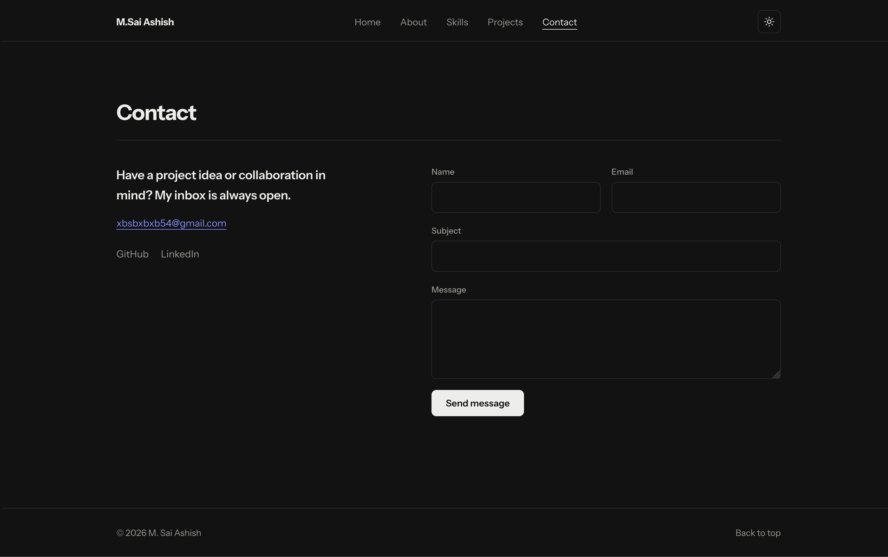

# portfolio-website

A minimal personal portfolio website built with HTML, CSS and
JavaScript. Made to introduce myself, share the things I work on and
showcase a few of my projects. I am an AI student interested in
artificial intelligence, computer vision and software development. I am
always learning, experimenting and open to suggestions or feedback.

[GitHub Repository](https://github.com/MsaiAshish/portfolio-website)

### features:

-   Minimal and responsive design
-   Light and dark themes
-   Saves the selected theme using LocalStorage
-   Mobile-friendly navigation menu
-   About and skills sections
-   Selected projects showcase
-   Contact section with a message form
-   Smooth section navigation and active navigation links

# Technologies

-   HTML5
-   CSS3
-   JavaScript
-   Google Fonts --- Instrument Sans

# Preview
The website includes the following sections:

## Home


## About


## Skills


## Projects



## Contact


# Running locally

Clone the repository:

``` bash
git clone https://github.com/MsaiAshish/portfolio-website.git
```

Move into the project folder:

``` bash
cd portfolio-website
```

Start a local server:

``` bash
python3 -m http.server 8000
```

Open `http://localhost:8000` in your browser.

# Connect
<p align="center">
  <a href=" https://github.com/MsaiAshish">
    
  </a>
       <a href="https://www.linkedin.com/in/mallipudi-saiashish-541953177/">
    
  </a>
       <a href="mailto:xbsbxbxb54@gmail.com">
    
  </a>
</p>
